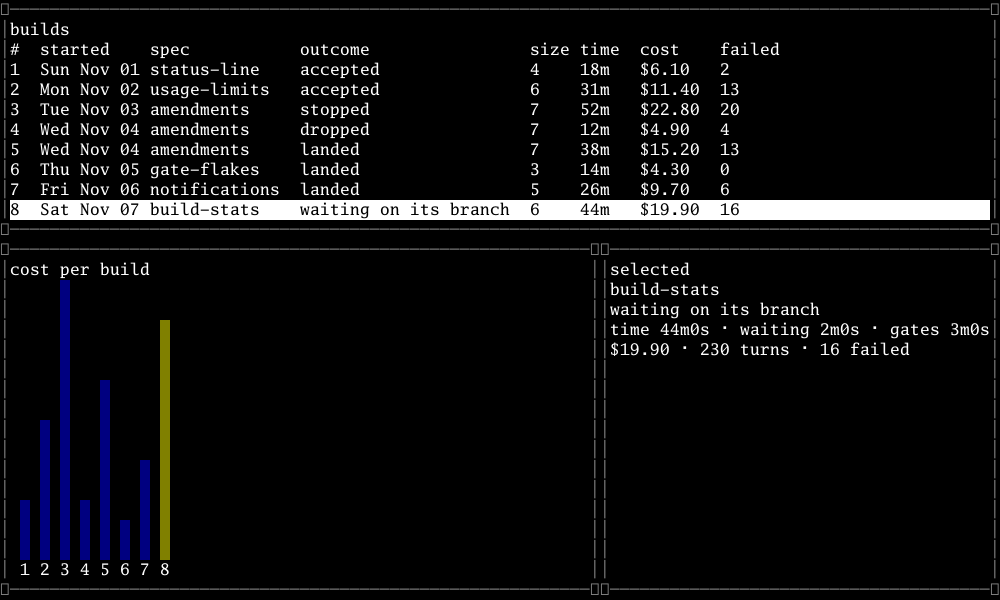

# Build the stats TUI on Bubble Tea v2 and Lip Gloss v2, and verify it through a pseudo-terminal that kiln owns

Question: What should a TUI for kiln's build stats be built on, and how can an agent verify how it behaves? Asked
2026-11-08.
Feeds: [spec 2](../../../specs/build-stats.md), and the future spec that builds the first slice.

This research read each library's repository, releases and module on 2026-11-08. The sources are in two notes:
[libraries](notes/libraries.md) and [verification](notes/verification.md). Three prototypes drew the same screen from
the same fake ledger: one on Bubble Tea, one on tview, and one on the standard library alone. Each was built by its
own agent, against one shared end-to-end contract. A fresh judge then scored the three by `docs/practices.md`
"Judging two API designs", without knowing this report's lean. The numbers and screens are in
[the run](runs/2026-11-08-prototypes.md). A second run tried Microsoft's tui-test beside kiln's own harness:
[tui-test](runs/2026-11-08-tui-test.md). The code was in `prototypes/`, a Go module of its own, so kiln's
`go test ./...` never built it. Spec 3 lifted `termtest` into `internal/termtest`, and deleted the prototypes as it
landed: `git show 48fd9542daf0:docs/research/tui/prototypes/<path>` prints each file.

## The recommendation

Each step is inferred from the findings below.

1. Draw the TUI with Bubble Tea v2 and Lip Gloss v2. Draw bar charts by hand; add ntcharts only for a line chart or
   a braille plot.
2. Hit-test the mouse with Lip Gloss layers, so the cells drawn and the cells clicked come from one layout function.
3. Lift `prototypes/termtest` into kiln as the acceptance tests' terminal: the real binary in a pseudo-terminal,
   read by the `charmbracelet/x/vt` emulator. An acceptance test then drives keys and the mouse, and reads the
   screen, without knowing which library drew it.
4. Test domain rules in one table through the model's `Update` and `View`, as practices' "Tests" asks.
5. Save each view's screen as text and as PNG, at a wide and a narrow size, and have the audit read them. No
   assertion in this research caught a broken layout; reading the screens caught every one.
6. In every terminal test, wait after each input for a fact that input causes, never for text already on screen.
7. Offer tui-test's CLI to build and audit sessions for exploring a TUI by hand, with no test written. Keep it out of
   `go.mod`.

Adopting them adds entries to `outside` in `arch_test.go`: Bubble Tea and Lip Gloss for the package that draws, and
`creack/pty` and `charmbracelet/x/vt` for the package that tests.

## Bubble Tea and tview are both reputable, and the rubric ties them

| Measure                | Bubble Tea v2 + Lip Gloss v2                 | tview v0.42.0                           | standard library + x/term |
|------------------------|----------------------------------------------|-----------------------------------------|---------------------------|
| latest release         | v2.1.1, 2026-10-28; 5 since July             | v0.42.0, 2025-08-27; installs `@master` | Go's own                  |
| stars, open issues     | 45,650, 277                                  | 14,148, 108                             | —                         |
| built on               | `ultraviolet`, untagged                      | tcell v2, while tcell is on v3.6        | —                         |
| prototype lines        | 165                                          | 180                                     | 388                       |
| modules built in       | 17                                           | 8                                       | 2                         |
| binary, stripped       | 3.8 MB                                       | 3.3 MB                                  | 1.8 MB                    |
| judge's pairwise score | ties tview 7–7, wins on hops; beats raw 12–0 | beats raw 15–2                          | last                      |

The judge's table, with every cited line, is in [the run](runs/2026-11-08-prototypes.md#the-judges-score). Bubble
Tea won the tie on measure 1: a click on a row is 4 hops in Bubble Tea, 6 in tview and 8 in the raw prototype. The
judge called the tie fragile: counted one way Bubble Tea wins 11–3, counted another tview wins 7–5.

What breaks the tie, outside the score:

- **Testing.** Bubble Tea's `Update` takes a message and returns a model, so a table test sends keys, clicks and
  sizes and reads `View()`, with no goroutine. tview's simulation screen needs the test to sync with tview's draw
  goroutine by hand; reading cells while it draws is a data race.
- **Traps.** The tview fork hit four rules the compiler skips: a second click within 500 ms arrives only as a double
  click; a mouse capture must return `MouseConsumed, nil` or the event goes on; `Box` setters return `*Box`, which
  breaks a chain; `SetScreen` resets a simulation screen to 80 × 25. The Bubble Tea fork hit two: Lip Gloss wraps
  text wider than `Width` rather than cutting it, and `tea.View.OnMouse` delivers through `go p.Send`, so two quick
  clicks can arrive out of order.
- **Upkeep.** tview's one tag since 2025 and its lag behind tcell v3 count against it. Bubble Tea's renderer rests on
  `ultraviolet`, which has no tagged release, and that counts against it.
- **What tview gives free.** Focus between panels, and a table that scrolls itself. Bubble Tea needs both written.

The raw prototype loses clearly: 195 of its lines repeat what a library already does, and it carries the most
unchecked rules. Its own terminal decoder treats an Esc at the end of a read as the key, which misreads a sequence
split across reads.

## What it looks like

The Bubble Tea prototype at 100 × 30, as `termtest.PNG` drew it for an agent to read:



The model is one struct, and `Update` is a switch. A click asks the layout which layer it hit:

```go
case tea.MouseClickMsg:
	if msg.Button == tea.MouseLeft && !m.open {
		m.click(m.layout().Hit(msg.X, msg.Y).ID())
	}
```

```go
// click selects the row or bar whose layer ID is id, and opens a row that was already selected.
func (m *model) click(id string) {
	kind, n, _ := strings.Cut(id, ":")
	i, err := strconv.Atoi(n)
	if err != nil {
		return
	}

	m.open = kind == "row" && i == m.sel
	m.sel = i
}
```

The weak point is the layer IDs: `"row:%d"` is written in `layout` and parsed back here, and a typo in either compiles
and silently does nothing. A slice would give the layers typed IDs, or one constructor and one parser beside each
other.

## Panels and graphs: yes, and a bar chart is 15 lines by hand

- **Panels.** Lip Gloss draws bordered boxes and joins them; its `Compositor` places layers at a cell and answers
  which layer a cell hit. tview's `Flex` and `Grid` lay out panels and resize them with no code.
- **Bar charts.** Each fork tried the chart library for its toolkit and dropped it. ntcharts' bar chart drew finer
  partial blocks, but brought `bubbles`, `bubblezone` and `x/image`, and a second hit-testing scheme beside the
  layers. tvxwidgets' bar chart takes only integers and has no mouse handler.
- **Line charts.** ntcharts v2 has line charts, sparklines and braille plots for Bubble Tea. None was tried. It is the
  reason to add ntcharts later.
- **A trap in every toolkit.** A full block `█` drawn in reverse video becomes a blank cell. Each prototype marks the
  selected bar with a color instead.

## Mouse and keyboard: yes, in all three

All three enable SGR mouse reporting, a terminal mode that reports a click's button, column and row as an escape
sequence. Ghostty is believed to support it; this was not tried in Ghostty. All pass the same scenarios: the arrows,
or `j` and `k`, move; Enter opens; Esc goes back; a click selects a row or a bar; a click on the selected row opens
it; and the wheel moves the selection. Bubble Tea v2 gives each kind its own message: `KeyPressMsg`, `MouseClickMsg`,
`MouseWheelMsg`. The judge found one behavior gap in the Bubble Tea prototype: while a build is open, the arrows still
move the hidden selection.

## How an agent verifies a TUI

The ecosystem uses four layers. The prototypes tried three:

```text
                     what it runs                 caught in this research
model test           Update and View, in process  domain rules, hit-testing at a size
toolkit test         teatest; tcell simulation    little more than the model test
pseudo-terminal      the binary, via x/vt         alt screen, SGR encoding, resize, restore on quit, two races
reading the screen   text and PNG dumps           every broken layout, at 70 × 20 and 60 × 16
```

- **The pseudo-terminal layer is the acceptance test.** kiln's acceptance tests already run the binary from the
  command line. `termtest` does that for a full-screen program in 211 lines: it runs the binary under `creack/pty`,
  feeds the output to `x/vt`, sends keys and clicks the way a terminal would encode them, and reads cells with their
  colors. All three prototypes passed its 7 scenarios 20 runs of 20.
- **go-internal's testscript can't serve.** Its `ttyin` writes the whole input at once and `ttyout` matches raw
  bytes, with no screen and no way to wait for a frame.
- **Wait for a fact the input causes.** The first contract checked a selected row right after waiting for its text.
  The text was already on screen, so the check read the old frame; Bubble Tea failed 10 runs of 10. Screens dumped
  after a resize showed the old size for the same reason. `WaitReversed` and `WaitMatch` poll for the effect.
- **Layout needs eyes.** Every prototype passed every assertion, including a resize. Reading the 60 × 16 dumps showed
  a lost border in Bubble Tea, lines wrapped mid-phrase and cut off in tview, and text over a border in raw. Two
  forks found more such faults the same way while building. `TestScreens` saves each view as text, ANSI and PNG.
- **An agent can read the PNG.** This session read the PNG above and saw the reverse-video row and the colored bars,
  which the text dump drops. `termtest.PNG` draws with Go Mono from `golang.org/x/image`, which lacks the rounded
  corners `╭╮╰╯`.
- **x/vt draws what Ghostty draws, on these screens.** tui-test runs a program on a real terminal's engine. On its
  Ghostty backend, the 7 scenarios passed for all three prototypes, 10 runs of 10. Given the same inputs, Ghostty
  and `x/vt` drew the same text and the same reverse-video cells on all 12 screens, 23,760 cells. Colors, wide
  characters and the kitty keyboard protocol were not compared.
- **tui-test's CLI lets an agent explore.** It ran the Bubble Tea prototype at 60 × 16 from the shell, clicked rows
  by their text, and saved a PNG in a full font that showed the lost borders. `termtest` works only inside a test.

## tui-test or termtest for the acceptance tests

| Outcome                      | termtest                                        | tui-test Go binding 0.1.1                     |
|------------------------------|-------------------------------------------------|-----------------------------------------------|
| scenarios pass, 10 of 10     | yes                                             | yes                                           |
| code kiln owns               | 211 lines                                       | none                                          |
| a check that can't race      | only since every check was made to poll         | every locator retries by design               |
| an ambiguous text            | `Find` takes the first match silently           | fails unless it matches once                  |
| what it adds                 | 20 Go modules, `x/vt` on untagged `ultraviolet` | 2 Go modules and a 14 MB prebuilt Rust engine |
| test binary                  | 6.2 MB                                          | 15.2 MB                                       |
| a fault in the harness       | Go a build session can read and fix             | native code kiln can't fix                    |
| runs in an auto-mode session | yes                                             | believed to need a permission rule            |

The fact that decides is the last two rows. kiln runs every build session in auto mode, with no developer there to
approve. This session's auto-mode guard refused tui-test's engine until the developer approved it. A harness kiln
owns is Go that the build that hits a fault in it can fix. tui-test's strengths are real: it owns no code in kiln,
and its strict locators guard against a bug `termtest` allows. `termtest` should take that rule: `Find` fails when its
text is on screen twice.

## Open questions, ranked, each with a lean

1. **Which library?** Lean: Bubble Tea v2 with Lip Gloss v2. The rubric ties it with tview; its pure `Update` makes
   the domain-rule tests a plain table, and it has the larger and more active upkeep. tview wins if the slice leans
   on focus and scrolling more than on tests.
2. **Should kiln own the terminal test layer?** Lean: yes, lift `termtest` into an `internal/` package used by
   acceptance tests, on `creack/pty` and `x/vt`, and make `Find` refuse a text that is on screen twice. The
   alternative, tui-test's Go binding, passed the same scenarios and drew the same screens, owns no code in kiln, and
   brings a native engine that kiln's auto-mode sessions may refuse.
3. **Should build and audit sessions get tui-test's CLI?** Lean: yes, installed on the machine and allowed in kiln's
   session settings, for exploring a TUI by hand. Nothing in the gate would need it.
4. **Should the audit read screen dumps?** Lean: yes, a wide and a narrow size per view, text and PNG. It is the only
   check here that found a broken layout. The cost is an audit that reads images.
5. **How does the TUI meet spec 2's plain text?** Lean: `kiln stats` stays plain text, which pipes and which spec 2's
   tests read, and the TUI opens with a flag or its own command. Opening it whenever stdout is a terminal is the
   alternative.
6. **Keep the prototypes checked in?** Lean: keep `docs/research/tui/prototypes/` until the slice lands, then delete
   it. It adds a `go.mod` with 31 modules under `docs/`, which kiln's own build never reads. Its `tuitest` package
   downloads tui-test's 53 MB module on first build.
