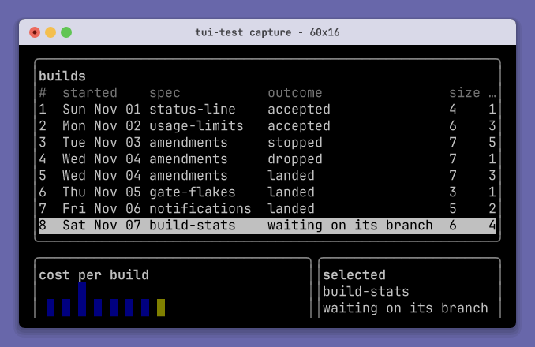

# 2026-11-08: Microsoft tui-test 0.1.1 beside termtest

The developer approved running tui-test's Go binding and its CLI. The Go binding ran the shared scenarios in
`prototypes/tuitest`, from `github.com/microsoft/tui-test/bindings/go@v0.1.1`. The CLI came from the 0.1.1 release's
`tui-test-aarch64-apple-darwin.tar.gz`. It ran from a scratch directory, since deleted.

## The scenarios pass on Ghostty

`prototypes/tuitest` ports e2e's 7 scenarios to tui-test's Ghostty backend, against all three prototypes.

```console
$ go test ./tuitest/ -count=10
ok  	kilntui/tuitest	26.218s
```

The scenarios read about the same: 56 lines against e2e's 61. tui-test needs no harness of kiln's own, where
`termtest` is 211 lines.

```go
// termtest
term.Type("kkkkk")
term.WaitReversed("stopped")

// tui-test
check(t, c.Type("kkkkk"))
inverse := c.GetByStyle(tt.TextStyle{Inverse: tt.Ptr(true)}, tt.StyleSelectorOptions{})
check(t, inverse.GetByText("stopped", tt.TextSelectorOptions{}).Expect(tt.LocatorExpectOptions{}))
```

## Ghostty and x/vt drew the same screens

`TestSameScreen` gives both terminals the same inputs. It then compares each row's text and each cell's reverse video,
for both views, at 100 × 30 and 60 × 16, for each prototype: 12 screens and 23,760 cells. No row and no cell
differed. Colors, wide characters and the kitty keyboard protocol were not compared.

The Alacritty backend kept tab characters in its text, where Bubble Tea's renderer had moved the cursor with a tab:
`waiting on its branch\t     \t`. Ghostty and xterm.js did not.

## What tui-test does that termtest doesn't

- **Every check retries.** A locator is a query run again on each try, so the two races `termtest` had at first can't
  be written. `termtest` matches that now only because each of its checks polls.
- **A locator must match once.** `GetByText("build-stats")` failed because the text was on screen twice, in the table
  and in the selected panel. `termtest.Find` silently takes the first. The CLI's `click text "gate-flakes"` refused
  its second click for the same reason, once the selected panel showed the name too.
- **The CLI drives a program with no test written.** `run --cols 60 --rows 16 --backend ghostty`, then `text`,
  `click text`, `find text --inverse`, `cells`, `screenshot -o x.png`. Its `usage` prints a cheat sheet for agents,
  and its exit codes say what failed: 1 an assertion, 2 usage, 3 no session.
- **Its PNG uses a full font.** At 60 × 16 it showed the Bubble Tea prototype's lost bottom borders, with every glyph
  drawn, `╭╮` included:



## Surprises

- In a regex locator, `^` anchors at a row's start, but `$` never matched, even on a row that ends where the pattern
  does.
- Every call takes an options struct, even an empty one, such as `tt.TextSelectorOptions{}`.

## Cost

| Measure                    | termtest                          | tui-test Go binding                               |
|----------------------------|-----------------------------------|---------------------------------------------------|
| code kiln owns             | 211 lines                         | none                                              |
| Go modules added           | 20, with `x/image` for the PNG    | 2: the binding and `purego`                       |
| native code                | none                              | a prebuilt Rust engine, 14 MB in the user's cache |
| module download            | small                             | 53 MB, with every platform's engine               |
| test binary                | 6.2 MB                            | 15.2 MB                                           |
| one scenario               | about 0.1 s                       | 0.13 to 0.29 s                                    |
| first Ghostty screen, cold | —                                 | 337 ms; Alacritty 62 ms                           |
| emulator                   | `x/vt` v0.1.0                     | Ghostty, Alacritty, Rio or xterm.js               |
| maturity                   | v0.1.0, on untagged `ultraviolet` | 0.1.1, after a full API rewrite since 2024        |

Before the developer approved it, this session's auto-mode guard refused to run both the CLI and `freeze`, as code
from outside. kiln runs every build session in auto mode (`internal/claude/claude.go`), with no developer there to
approve. A build session would need a permission rule in kiln's settings to run tui-test. This is believed from this
session's refusal, and was not tried in a kiln build.
